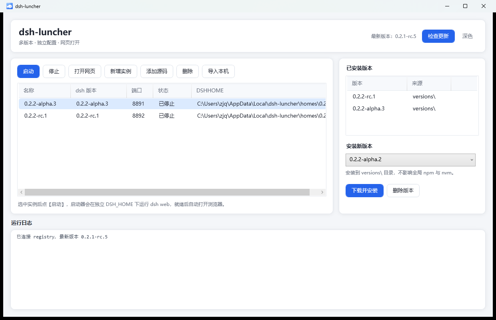

# dsh-luncher

Windows 图形界面启动器，用来管理多个 dsh 实例：每个实例有独立的 `DSH_HOME`，配置、会话、凭证互不污染。



## 界面

浅色主题是默认值，右上角「深色 / 浅色」一键切换，选择记在 `launcher.json` 的 `theme` 字段里。

主题色板在 `themes/light.xaml` 和 `themes/dark.xaml`，改配色只需要动这两个文件。

> 图标是一只原创的白色小鲸鱼（蓝色渐变底），**不是** DeepSeek 官方吉祥物。DeepSeek 的[品牌指南](https://github.com/deepseek-ai/deepseek-harness/blob/master/BRAND_GUIDELINES.md)要求第三方项目避免使用官方素材，以免被误认为官方背书。

## 安装

**方式一：安装包（推荐）**

下载 [Releases](https://github.com/ZhouJunquanaaa/dsh-launcher/releases) 里最新的 `dsh-luncher-setup-*.exe`，双击安装。装完桌面和开始菜单会有「dsh-luncher」，双击即用。

- 按用户安装到 `%LOCALAPPDATA%\Programs\dsh-luncher`，不需要管理员权限
- 用户数据（配置、会话、版本）放在 `%LOCALAPPDATA%\dsh-luncher`，卸载时保留
- 卸载：开始菜单「Uninstall dsh-luncher」，或设置 → 应用

> **从 1.0.x 升级**：旧版名字是 `dsh-launcher`，AppId 不同，请先卸载旧版再装这个。首次启动会把 `%LOCALAPPDATA%\dsh-launcher` 的数据自动迁移到 `%LOCALAPPDATA%\dsh-luncher`。

**方式二：免安装**

把仓库下载下来，直接双击 `dsh-luncher.exe`。此时数据就放在程序旁边（便携模式）。

> **为什么没有黑窗口**：快捷方式指向的是 `dsh-luncher.exe`——一个 5 KB 的 WinExe，用
> `CreateNoWindow` 拉起 `pwsh -File dsh-luncher.ps1`，所以不会像 `.cmd` 那样先弹一个控制台。
> 源码在 `installer/launcher.cs`，`build.ps1` 会用系统自带的 csc.exe 现场编译。

## 前置要求

| 依赖 | 用途 | 检查命令 |
|---|---|---|
| PowerShell 7 | 运行 GUI（WPF） | `pwsh -v` |
| Node.js | 运行 dsh | `node -v` |
| pnpm 11.28.5 | 仅源码模式构建需要 | `pnpm -v` |

没装 PowerShell 7 的话：`winget install Microsoft.PowerShell`。

## 两种实例来源

| 模式 | 来源 | 实际启动命令 | 适用场景 |
|---|---|---|---|
| **npm 版本** | npm registry，装进 `versions\<版本>\` | `node <版本>\node_modules\@deepseek-ai\dsh\lib\bin.js web` | 用发布版，多版本并存 |
| **源码** | 本地 deepseek-harness checkout | `node --import tsx/esm apps\cli\src\bin.ts web` | 改代码、跟 master |

两种模式都**不经过 npm 启动**：npm 只在「下载版本」这一步用来装包，运行阶段是 node 直接跑入口文件。

## 目录结构

```
dsh-luncher.exe      双击入口（WinExe，不闪控制台）
dsh-luncher.cmd      命令行/便携入口（会开控制台）
dsh-luncher.ps1      主程序（PowerShell 7 + WPF）
ui.xaml               界面定义
launcher.json         实例配置（自动生成）
versions\             npm --prefix 安装的 dsh 版本
homes\                每个实例独立的 DSH_HOME
logs\                 每次启动的 stdout / stderr 日志
```

## 使用

双击 `dsh-luncher.cmd`。

| 按钮 | 作用 |
|---|---|
| 启动 | 在独立 DSH_HOME 下跑 `dsh web --port <端口> --no-open`，轮询端口就绪后自动打开**带 token 的** URL |
| 停止 | `taskkill /T /F` 结束整个进程树 |
| 打开网页 | 重新打开该实例的 URL（含 token） |
| 新增实例 | 从已安装版本里挑一个，指定端口和工作目录 |
| 添加源码 | 选 deepseek-harness 目录，以 tsx 直跑源码 |
| 删除 | 只删配置，保留 home 目录 |
| 导入本机 | 扫描 nvm 安装的 dsh，生成实例 |
| 检查更新 | 查 registry 的 dist-tags（latest / next / alpha），右侧可一键装到 `versions\` |
| 删除版本 | 删除已安装的 dsh 版本；可勾选连带删除使用它的实例、配置目录（DSH_HOME）和源码 checkout |

> dsh web 启动时会打印 `http://127.0.0.1:<port>/?token=...`，启动器会从日志里抓这个 token，直接用裸地址打开会过不了浏览器信任校验。

## 源码模式准备

本机实测耗时：解压 20 651 个文件 → `pnpm install` 约 2 GB / 86 000 个文件 → `build:artifacts` 207 秒（8 个 gate 全过）。

```powershell
# 1. 取源码
#    本机 git clone 会卡在 pack 下载（tmp_pack 一直是 0 字节），用 codeload tarball 更稳
curl.exe -L https://codeload.github.com/deepseek-ai/deepseek-harness/tar.gz/refs/heads/master -o dsh.tgz
mkdir deepseek-harness
tar -xzf dsh.tgz -C deepseek-harness --strip-components=1

# 2. 装依赖（Node 26 已移除 corepack，pnpm 需单独装）
npm i -g pnpm@11.28.5
cd deepseek-harness
pnpm install

# 3. 构建产物（tsc 项目引用 + tsdown 打包 + Web 前端）
#    tarball 解压的目录没有 .git，构建脚本读不到提交号，必须给一个
$env:DSH_CLIENT_COMMIT_HASH = 'fcc0ad4'
pnpm run build:artifacts
```

完成后在启动器里点【添加源码】，选中该目录即可。启动器会用
`node --import tsx/esm apps\cli\src\bin.ts web` 直跑源码，不经过 npm。

> 想跑完整校验（含类型检查）用 `pnpm run build`；只想跑起来用 `build:artifacts` 就够。

## 已知问题与处理

| 现象 | 原因 | 处理 |
|---|---|---|
| `git clone` 长时间无进度，`.git` 里 pack 一直是 0 字节 | 本机到 GitHub 的 pack 传输被卡 | 改用 codeload tarball |
| `pnpm install` 卡在 `cdn.sheetjs.com` 超时 | SheetJS 的 CDN 在 pnpm 里不稳定 | 已把 tarball 放到 `vendor/xlsx-0.20.3.tgz`，并在 `pnpm-workspace.yaml` 里 override |
| 打开网页提示无权限 | 漏了 URL 里的 token | 用【打开网页】按钮，不要手敲地址 |
| 点「下载并安装」后报 404 / 安装失败 | npm 收到的包名被拆开（历史 bug，1.0.1 已修） | 升级到 1.0.1 或更新 |
| 界面无响应或异常退出 | 未捕获异常 | 看 `%LOCALAPPDATA%\dsh-luncher\logs\crash.log` |
| `pnpm run build` 报 `git rev-parse HEAD` 失败 | 用 tarball 解压的目录没有 `.git`，构建脚本要读提交号 | 构建前设 `$env:DSH_CLIENT_COMMIT_HASH='fcc0ad4'`（任意 7-40 位十六进制），或 `git init` 后提交一次 |

## 配置格式

`launcher.json`：

```json
{
  "version": 1,
  "instances": [
    {
      "name": "0.2.2-alpha.3",
      "dshVersion": "0.2.2-alpha.3",
      "bin": "D:\\APPS\\nvm\\installs\\v26.13.0\\node_modules\\@deepseek-ai\\dsh\\lib\\bin.js",
      "dshHome": "D:\\Workspace\\dsh-luncher\\homes\\0.2.2-alpha.3",
      "port": 8890,
      "cwd": "D:\\Workspace"
    },
    {
      "name": "src-deepseek-harness",
      "dshVersion": "0.2.2-rc.1",
      "source": "D:\\Workspace\\deepseek-harness",
      "dshHome": "D:\\Workspace\\dsh-luncher\\homes\\src-deepseek-harness",
      "port": 8891
    }
  ]
}
```

`bin` 与 `source` 二选一。

## 环境要求

- Windows 10/11
- PowerShell 7（`pwsh`），WPF 需要 .NET Desktop Runtime
- Node（`node` 在 PATH 中）
- 源码模式额外需要 pnpm 11.28.5
